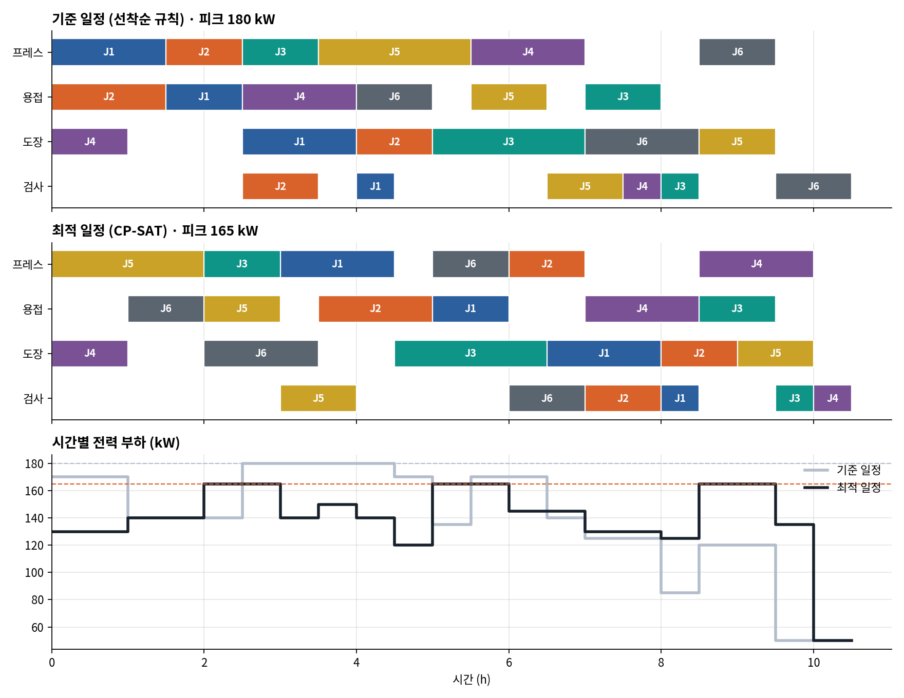
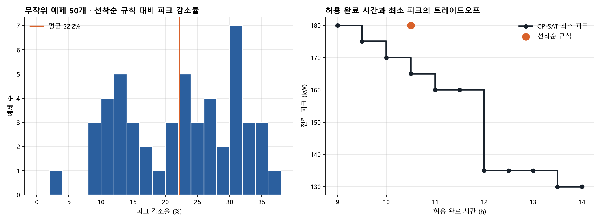
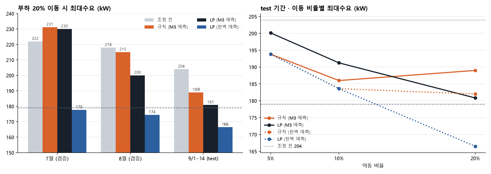
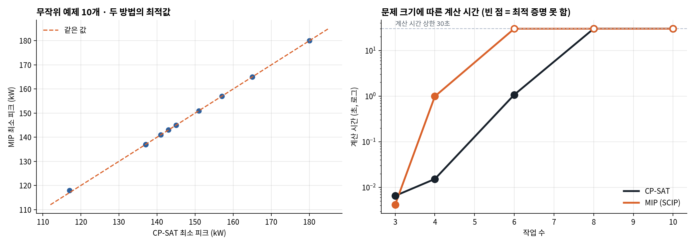

# Job-Shop 스케줄링 + 전력 피크 최소화 PoC

제조데이터 분석 경진대회에서는 **"피크 부하의 x%를 여유 시간으로 옮긴다"는 고정 규칙**으로 생산 일정을 조정했습니다.
10%를 옮기면 최대수요가 줄었지만, 많이 옮기면 부하를 받은 시간대에 새 피크가 생기는 한계가 있었습니다.

이 PoC는 같은 질문을 **제약 최적화(Google OR-Tools CP-SAT)** 로 다시 풀어 봅니다.



## 문제 설정 (가상 공장)

- 설비 4대(프레스, 용접, 도장, 검사), 작업 6개, 작업마다 3~4개 공정
- 공정마다 소요 시간(30분 단위)과 가동 전력(kW)이 있고, 상시 부하 40 kW
- 실제 공장 데이터가 아닌 **개념 검증용 예제**입니다

## 비교한 두 일정

| | 기준 일정 | 최적 일정 |
|---|---|---|
| 방식 | 설비가 비고 이전 공정이 끝나면 바로 시작 (선착순 규칙) | CP-SAT으로 같은 완료 시간 안에서 피크 최소화 |
| 완료 시간 | 10.5시간 | 10.5시간 |
| 전력 피크 | 180 kW | **165 kW (−8.3%)** |

완료 시간은 그대로 두고, 공정 순서만 바꿔 동시에 켜지는 고부하 설비를 분산했습니다.

## 모델

**결정변수**: 각 공정의 시작 시각 (IntervalVar)

**제약**
- 설비 중복 금지: 한 설비는 한 번에 한 공정만 → `AddNoOverlap`
- 공정 선후 관계: 다음 공정은 이전 공정이 끝난 뒤 시작 → `start[k+1] >= end[k]`
- 전력: 시간별 동시 가동 전력 합 ≤ 피크 → `AddCumulative` (용량을 변수로 두고 최소화)
- 납기: 완료 시간 ≤ 기준 일정의 완료 시간

**목적함수** (2단계)
1. 피크 최소화
2. 그 피크를 넘지 않는 범위에서 완료 시간 최소화

## 추가 검증

예제 하나의 결과가 우연이 아닌지, 그리고 납기와 비용 사이에서 어떤 선택지가 있는지 확인했습니다.



### 1) 무작위 예제 50개

작업 구성(공정 순서, 소요 시간 1~4칸, 설비별 전력)을 무작위로 바꾼 예제 50개에서
선착순 규칙과 CP-SAT 피크 최소화(완료 시간은 선착순 규칙 이하로 제한)를 비교했습니다.

| 지표 | 결과 |
|---|---|
| 피크 감소율 평균 | **22.2%** |
| 중앙값 | 22.9% |
| 범위 | 3.0% ~ 37.0% |
| 피크가 줄어든 예제 | 50 / 50 |
| 최적해 증명 | 50 / 50 (OPTIMAL) |

완료 시간을 늦추지 않고도 모든 예제에서 피크가 줄었습니다. 기본 예제(8.3%)는 감소 폭이 작은 편에 속합니다.

### 2) 완료 시간과 피크의 트레이드오프

기본 예제에서 허용 완료 시간을 30분씩 늘려 가며 최소 피크를 구했습니다.

| 허용 완료 시간 | 최소 피크 |
|---|---|
| 9.0시간 (가장 빠른 일정) | 180 kW |
| 10.5시간 (선착순 규칙과 같은 완료 시간) | 165 kW |
| 11.0시간 | 160 kW |
| 12.0시간 | 135 kW |
| 13.5시간 | 130 kW |

- 선착순 규칙(10.5시간, 180 kW)은 CP-SAT의 가장 빠른 일정(9.0시간, 180 kW)보다 완료 시간과 피크 모두 나쁩니다.
- 피크는 완료 시간에 따라 계단식으로 줄고, 11.5시간 → 12시간 구간에서 25 kW가 크게 떨어집니다.
  현장에서는 이 곡선을 보고 "30분 늦추는 대신 피크를 얼마나 낮출지"를 판단할 수 있습니다.

## 경진대회 실제 데이터에 적용

가상 예제를 넘어, 경진대회의 실제 데이터(KAMP 자원 최적화 데이터)에서
**하루 전 일정 조정을 고정 비율 규칙 대신 선형계획(LP)으로** 풀어 비교했습니다.



### 설정
- 입력: 하루 전 예측(M3, LightGBM + 가동 계획), 실제 전력, 가동 계획, 받는 시간의 예상 부하 (`data/kamp_dayahead.csv`)
- 기간: 7·8월(교차검증 예측), test 9/1~9/14
- **규칙** (경진대회 방식): 예측이 168kW 이상인 시간의 부하 x%를, 같은 날 경보가 없는 가동 시간 중 예상 부하가 낮은 순으로 이동
- **LP**: 같은 예측과 같은 한도(한 시간에서 뺄 수 있는 양 ≤ x × 예측, 받는 양 ≤ x × 예상 부하, 받은 뒤 178kW 이하) 안에서
  그날의 계획상 최대 부하를 최소화하도록 어느 시간에서 얼마를 빼고 어디에 넣을지 한꺼번에 결정 (OR-Tools GLOP)
- 두 방법 모두 하루 전 예측으로 이동량을 정하고, 같은 이동량을 **실제 전력**에 적용해 평가. 하루 총부하는 그대로
- 규칙 구현은 경진대회 결과(예: test 10% → 최대수요 186kW)를 그대로 재현하는 것을 확인

### 결과: 최대수요 (kW)

| 기간 | 조정 전 | 규칙 10% | LP 10% | 규칙 20% | LP 20% | LP 20% (완벽 예측) |
|---|---|---|---|---|---|---|
| 7월 | 222 | 216.6 | 217.0 | 231.2 | 230.0 | **177.6** |
| 8월 | 218 | 215.0 | **207.9** | 215.0 | **200.0** | **174.4** |
| test | 204 | **186.0** | 191.2 | 189.0 | **180.8** | **166.5** |

### 해석 (좋은 결과만 고르지 않고 그대로 적었습니다)
- **많이 옮길수록 LP가 낫습니다.** 20% 이동에서 규칙은 받는 시간에 새 피크를 만들어 test 최대수요가 오히려 189kW로 올랐지만,
  LP는 180.8kW까지 낮췄습니다. 7월 새 피크 시간도 규칙 12시간 → LP 4시간으로 줄었습니다.
- **10% 이동에서는 엇갈립니다.** 8월은 LP가 낫지만(215 → 207.9), test는 규칙이 더 좋았습니다(186 vs 191.2).
- **병목은 예측 정확도입니다.** 실제 전력을 안다고 가정하면(완벽 예측) LP는 20% 이동으로 세 기간 모두 피크 시간을 0으로 만들지만,
  하루 전 예측을 쓰면 그 이점이 크게 줄어듭니다. 특히 요일 일정이 바뀐 7월은 예측이 틀려 두 방법 모두 최대수요를 낮추지 못했습니다.
- 결론: 최적화는 정보가 정확할수록 큰 이점을 내고, 실제 운영에서는 **예측의 불확실성을 제약에 직접 반영하는 최적화**가 필요합니다.
  이것이 석사과정에서 풀고 싶은 문제입니다.

## 같은 문제를 MIP로도 풀어 비교 (CP-SAT vs 혼합정수계획)

지금까지의 스케줄링은 CP-SAT(제약 프로그래밍)으로 풀었습니다. 같은 문제를 **시간 구간별 0/1 변수를 쓰는 혼합정수계획(MIP)** 으로
다시 정식화해 오픈소스 MIP 솔버(SCIP)로 풀고, 결과와 계산 시간을 비교했습니다. (`mip_compare.py`)



### MIP 정식화

- 변수: `x[o, t] ∈ {0,1}` (공정 o가 t칸에 시작하면 1), `P ≥ 0` 연속 (전력 피크) → 0/1 변수와 연속 변수가 섞인 MIP
- 목적: `P` 최소화
- 제약
  1. 공정마다 시작은 한 번: `Σ_t x[o,t] = 1`
  2. 공정 선후 관계: `S[다음] ≥ S[o] + d[o]`, `S[o] = Σ_t t·x[o,t]`
  3. 설비 중복 금지: 시간 칸마다 `Σ (그 칸에 가동 중인 같은 설비 공정) ≤ 1`
  4. 전력: 시간 칸마다 `Σ p[o] · (그 칸에 가동 중이면 1) ≤ P`
  5. 완료 시간 상한: 시작 가능 칸을 `t ≤ H − d[o]`로 제한 (H = 선착순 규칙의 완료 시간)

CP-SAT에서는 3번이 `AddNoOverlap`, 4번이 `AddCumulative` 한 줄이지만, MIP에서는 **시간 칸마다 제약식을 하나씩** 만들어야 합니다.

### 결과 (방법마다 문제당 계산 시간 상한 30초)

| 비교 | CP-SAT | MIP (SCIP) |
|---|---|---|
| 기본 예제 최소 피크 | 165 kW, 최적 증명 (3초) | 165 kW, 30초 안에 최적 증명 못 함 |
| 무작위 10개 · 같은 최적값 | 9 / 10 | 9 / 10 |
| 무작위 10개 · 최적 증명 | 10 / 10 | 8 / 10 |
| 무작위 10개 · 계산 시간 중앙값 | **0.08초** | 3.9초 |

| 작업 수 | CP-SAT | MIP (SCIP) | MIP 변수 수 |
|---|---|---|---|
| 3 | 148 kW, 증명 (0.01초) | 148 kW, 증명 (0.00초) | 113 |
| 4 | 117 kW, 증명 (0.02초) | 117 kW, 증명 (0.99초) | 232 |
| 6 | 161 kW, 증명 (1.1초) | 161 kW, 증명 못 함 (30초) | 442 |
| 8 | **152 kW**, 증명 못 함 (30초) | 157 kW, 증명 못 함 (30초) | 634 |
| 10 | **136 kW**, 증명 못 함 (30초) | 142 kW, 증명 못 함 (30초) | 1,241 |

### 해석
- **두 정식화가 같은 답을 냅니다.** 둘 다 최적을 증명한 예제에서는 최소 피크가 모두 같아, 정식화가 서로를 검증합니다.
  다른 1개(117 vs 118)는 MIP가 시간 안에 최적을 증명하지 못한 경우입니다.
- **이 스케줄링 문제에는 CP-SAT이 훨씬 빠릅니다.** 설비 중복·전력 누적 같은 스케줄링 전용 제약을 직접 다루기 때문입니다.
  MIP는 시간 칸 수만큼 변수와 제약이 늘어(작업 10개에서 변수 1,241개) 큰 문제일수록 불리했습니다.
- **그래도 MIP를 배워야 하는 이유**: 경진대회 데이터처럼 옮기는 양(kW)이 연속값이거나, 비용·재고 같은 연속 변수가 섞이면
  MIP·LP 형태가 자연스럽고, 상용 솔버(Gurobi, CPLEX)와 LP 완화로 얻는 하한 정보도 쓸 수 있습니다.
- 한계: 오픈소스 솔버 SCIP와 시간 구간 정식화 하나만 비교했습니다. 다른 정식화(선후 관계를 0/1 변수로 두는 방식)나
  상용 솔버에서는 결과가 달라질 수 있습니다.

## 미니 MES로 확장

PoC의 최적화 모델을 **SQLite DB → FastAPI 최적화 API → Streamlit 관리자 화면**으로 연결했습니다.
작업 지시를 DB에 등록하고, 화면에서 버튼을 누르면 API가 OR-Tools로 일정을 계산해 간트 차트와 전력 부하로 보여 줍니다.
자세한 구조와 실행 방법은 [`mini_mes/README.md`](mini_mes/README.md)에 있습니다.

## 실행

```bash
pip install -r requirements.txt
python jobshop_peak.py   # 최적화 → result.json
python visualize.py      # schedule_comparison.png, gantt_interactive.html
python experiments.py    # 무작위 예제 50개 + 트레이드오프 곡선 → experiments.json, experiments.png (수 분 소요)
python kamp_reschedule.py   # 경진대회 데이터: 규칙 vs LP → kamp_reschedule_summary.csv
python kamp_plot.py         # kamp_reschedule.png
python mip_compare.py       # CP-SAT vs MIP 비교 → mip_compare.json, mip_compare.png (약 10분)
```

## 배운 점과 다음 단계

- 고정 비율 규칙은 "어디로 옮겨야 새 피크가 안 생기는지"를 모르지만, 제약 최적화는 모든 공정을 함께 고려해 그 답을 찾습니다.
- 결과 하나가 아니라 여러 예제에서 분포로 확인해야, 개선이 우연인지 구조적인지 말할 수 있습니다.
- 최적화는 정답 하나가 아니라 "완료 시간과 비용 사이의 선택지"를 보여 줍니다.
- 다음 단계: 경진대회의 예측 전력(불확실성 포함)을 입력으로 받아, 예측 오차 범위까지 제약에 반영하는 스케줄링으로 확장하는 것

## 참고

- `data/kamp_dayahead.csv`는 팀 저장소 [kamp-resource-optimization-benchmark](https://github.com/SeoHyun1024/kamp-resource-optimization-benchmark)의
  하루 전 예측 결과(11_schedule_simulation.py 입력)에서 가져왔습니다. 원자료는 중소벤처기업부·KAIST KAMP 자원 최적화 AI 데이터셋입니다.

Google OR-Tools 공식 Job-Shop 예제의 구조(설비 중복 금지, 공정 선후 관계)를 출발점으로,
전력 피크 제약(`AddCumulative`), 선착순 규칙과의 비교, 추가 검증 실험을 더했습니다.
