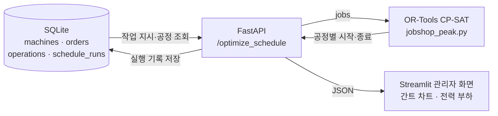
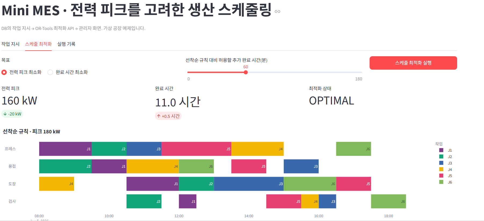
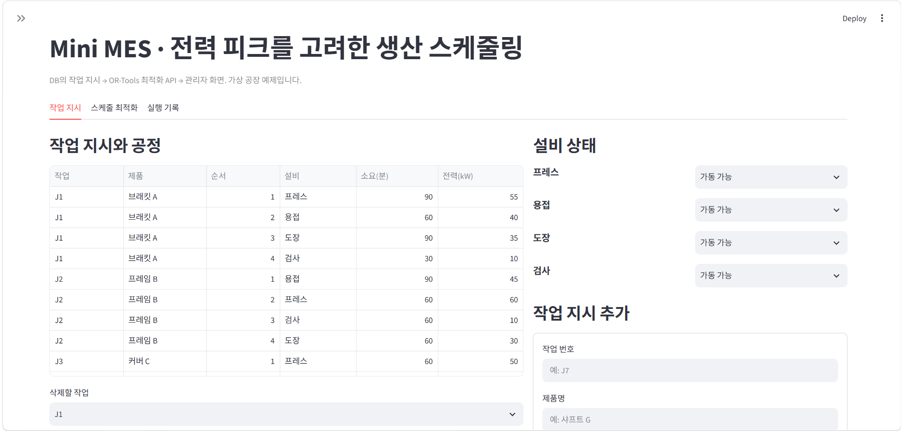
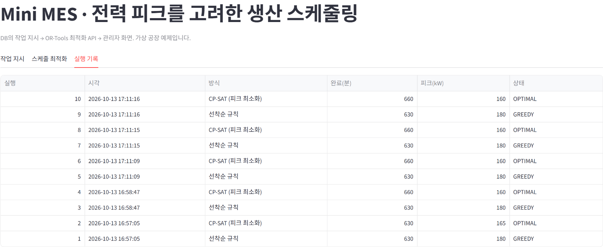

# Mini MES · 전력 피크를 고려한 생산 스케줄링

PoC로 만든 최적화 모델(`../jobshop_peak.py`)을 **DB → API → 관리자 화면**으로 연결한 축소판 MES입니다.
실제 공장 설비 없이, 노트북 한 대에서 MES의 데이터 흐름을 재현하는 것이 목표입니다.



## 구성

| 파일 | 역할 |
|---|---|
| `db.py` | SQLite 스키마와 초기 데이터 (설비 4대, 작업 6개) |
| `api.py` | FastAPI 서버: 작업 지시 CRUD, 설비 상태 변경, 최적화 실행, 실행 기록 조회 |
| `app.py` | Streamlit 화면: 작업 지시 관리, 최적화 실행과 간트 차트, 실행 기록 |
| `test_api.py` | API 흐름 테스트 (최적화 결과, 설비 중복 없음, 작업 추가, 점검 중 설비 처리) |

## 화면

| 스케줄 최적화 | 작업 지시 |
|---|---|
|  |  |



## API

| 메서드 | 경로 | 설명 |
|---|---|---|
| GET | `/orders` | 작업 지시와 공정 목록 |
| POST | `/orders` | 작업 지시 추가 (설비, 소요 시간 30분 단위, 전력) |
| DELETE | `/orders/{job_id}` | 작업 지시 삭제 |
| GET / PATCH | `/machines`, `/machines/{id}` | 설비 상태 조회·변경 (가동 가능 / 점검 중) |
| POST | `/optimize_schedule` | 선착순 규칙과 CP-SAT 최적 일정을 계산해 저장하고 반환 |
| GET | `/schedules`, `/schedules/{run_id}` | 실행 기록과 일정 |

`/optimize_schedule` 요청 예시:

```json
{"objective": "peak", "extra_minutes": 0, "time_limit_s": 10}
```

- `objective`: `peak`(전력 피크 최소화) 또는 `makespan`(완료 시간 최소화)
- `extra_minutes`: 피크 최소화 시 선착순 규칙보다 늦어져도 되는 시간 (30분 단위)
- 점검 중인 설비를 쓰는 작업이 있으면 409로 거부하고 해당 작업을 알려 줍니다

## 실행

저장소 최상위 폴더에서 패키지를 설치한 뒤, 터미널 두 개로 실행합니다.

```bash
pip install -r requirements.txt
cd mini_mes

# 터미널 1: API 서버
uvicorn api:app --reload
# → http://127.0.0.1:8000/docs 에서 API를 직접 호출해 볼 수 있음

# 터미널 2: 관리자 화면
streamlit run app.py
# → 브라우저에서 '스케줄 최적화 실행' 클릭

# 테스트
python test_api.py
```

처음 실행하면 `mes.db`가 자동으로 만들어지고 예제 데이터가 들어갑니다. 초기화하려면 `python db.py`.

## 설계에서 신경 쓴 점

- **최적화 모델은 하나만 둡니다.** API는 상위 폴더의 `jobshop_peak.py`를 그대로 불러 써서, PoC 실험 결과와 화면 결과가 항상 같습니다.
- **기준선과 함께 보여 줍니다.** 최적 일정만 보여 주지 않고 선착순 규칙 일정을 같이 계산·저장해, 얼마나 나아졌는지 바로 비교할 수 있게 했습니다.
- **입력을 먼저 검증합니다.** 없는 설비, 중복 작업 번호, 30분 단위가 아닌 소요 시간, 점검 중 설비는 최적화 전에 막습니다.
- **실행 기록을 남깁니다.** 언제 어떤 방식으로 돌렸고 피크가 얼마였는지 DB에 쌓아, 계획 변경 이력을 추적할 수 있습니다.

## 한계와 다음 단계

- 시간 단위는 30분, 하루 일정만 다룹니다.
- 실제 MES라면 설비 가동 기록·실적이 실시간으로 들어오고, 일정이 계속 갱신되어야 합니다.
  다음 단계로 경진대회의 하루 전 전력 예측을 입력으로 받아, 예측 오차까지 고려한 일정으로 확장하는 것을 목표로 합니다.
